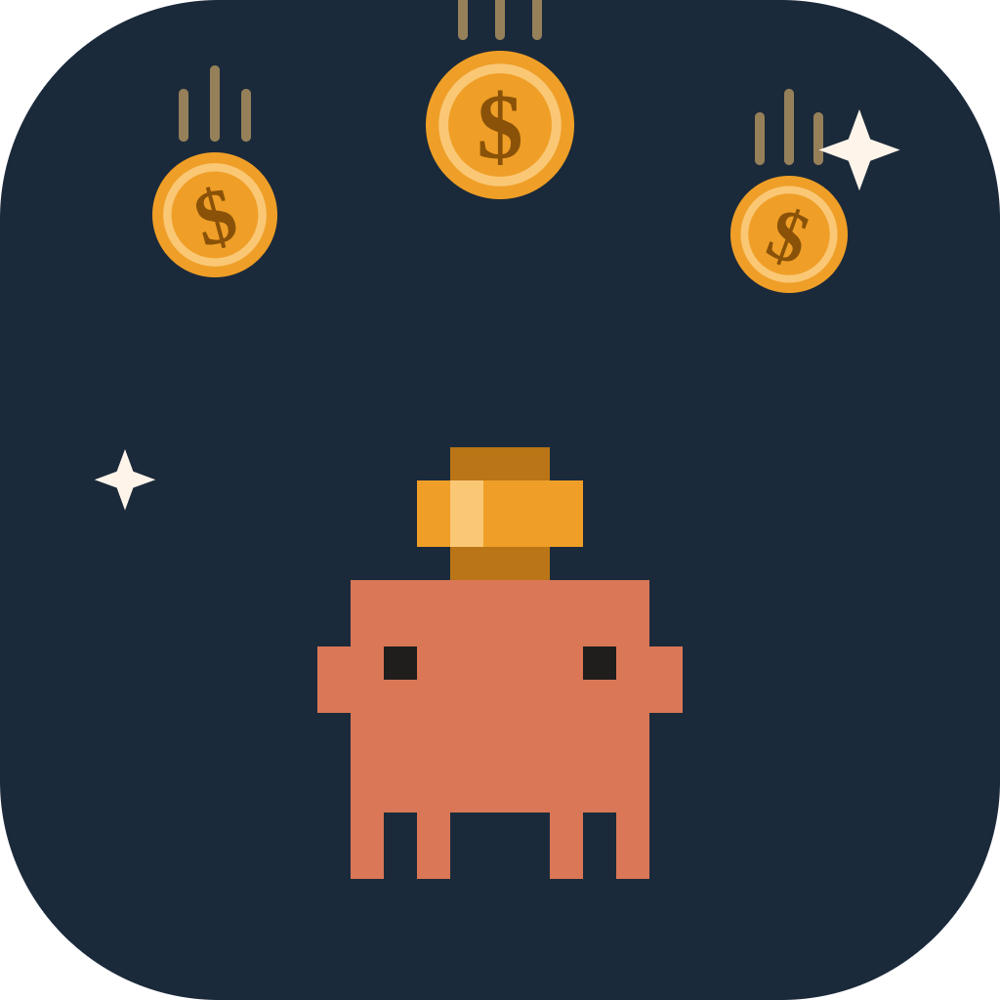
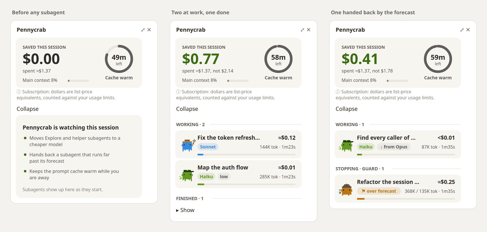

<p align="center"></p>

<h1 align="center">pennycrab</h1>

<p align="center">The crab that counts your pennies: a Claude Code mod that makes the same work cost less, and shows you where the money goes.</p>

<p align="center">
  <picture>
    <source media="(prefers-color-scheme: dark)" srcset="assets/pane-dark.png">
    
  </picture>
</p>
<p align="center"><sub>The pane as pennycrab draws it in the desktop app, from its own drawing code.</sub></p>

## What it does

- **Explore runs on Haiku.** The built-in Explore subagent only reads and searches, so it runs on the cheapest model, whatever model your session uses. General-purpose subagents, which also edit, run on Sonnet when your session is on Opus or Fable.
- **Your cache stays warm while you are away.** Shortly before the conversation's prompt cache expires, one small ping renews it. The message you send when you come back reads the conversation from the cache instead of paying to write it again.
- **Runaway subagents hand back what they found.** pennycrab learns how many tokens your runs of each kind take. A subagent far past that, or one repeating the same call, is asked to wrap up and hand back what it has, so the work already paid for is not lost.
- **A live pane shows it all.** One crab per subagent, dressed for the model it runs on, with its tokens, cost and time; what was saved; how long the cache stays warm.

## Does it cost quality?

- **Explore on Haiku: no.** Explore reads files and reports what it found; it never writes code. In the live run below, Haiku described the same 32 files as Opus.
- **General-purpose on Sonnet: a trade-off.** These subagents edit code, and Sonnet is not Opus. If you want no trade-off, set `router` to `explore`: Explore still moves to Haiku, and every subagent that writes keeps your model.
- **The cache pings: no.** A ping is a side request over your conversation as it stands, answered with one word; the reply is not added to your conversation.
- **The forecast: only for runs far off course.** A subagent is nudged only past what 9 runs in 10 of its kind take, plus half again, and handed over only past twice that. When it is, its answer says so and what it did not check, so the session that started it can pick up from there.

## What it saved in live runs

Measured with Claude Code 2.1.308, at list prices as Claude Code computes them, one run each.

| | Without pennycrab | With pennycrab |
| --- | --- | --- |
| One Explore over 32 files, from an Opus session | $0.509, 56 s (on Opus) | $0.013, 24 s (on Haiku), the same files described |
| The same Explore on Sonnet | $0.247, 33 s | $0.013, 24 s |
| First message after an 8-minute pause, 61K tokens, 5-minute cache | $0.088 to $0.153, first token in 3.5 s | $0.019 including the pings, first token in 1.8 s |
| First message after 65 minutes away, 61K tokens, a subscription's 1-hour cache | $0.244 (all 61K tokens written again), first token in 5.8 s | $0.013 including the one ping at 59 minutes, first token in 3.3 s |
| Explore over 109 files, with a $0.50 spend cap (pennycrab 0.4) | no limit | stopped at the cap, 97 files read and handed back with the 12 it skipped |
| Time added per subagent tool call | | 5 to 6 ms |

The token forecast of 0.6 hands subagents back the same way the spend cap did; it has no live measurement of its own yet.

## Install

In a terminal session of Claude Code:

```
/plugin install pennycrab --marketplace Batman110391/pennycrab
```

Answer `y` to add the marketplace, then pick a scope. In the desktop app, where `/plugin` does not run: click **+** next to the prompt box, then **Plugins**, **Add marketplace** with `Batman110391/pennycrab`, then **Add plugin**.

- Update: `claude plugin update pennycrab`
- Remove: `/plugin uninstall pennycrab`

## What you see

- **The band above the prompt.** The crabs at work and how many, what was spent and saved, and two buttons: **Pane** and **⚙ Settings**.
- **The pane** (the **Pane** button, or `/pennycrab`). At the top: what was saved, what was spent, the main context, and the cache as a ring that empties as it nears its lapse. Below, one card per subagent, running ones first:
  - its model, and the one it was moved from;
  - the tool it is using;
  - its context, its tokens against its forecast, its cost and time.

  A subagent that was handed back moves under **Guard**, with why: over forecast, loop or over budget. The pane opens by itself when a wave of subagents starts, where it docks beside the conversation.
- **Settings** (the **⚙ Settings** button, or `/pennycrab settings`). One menu per option below, each with a line on what its value does, and **Reset to defaults**. A change applies at once.
- **The status line.** Up to two running subagents with their model's letter, context and time, then what was saved.
- **A toast after your first message.** What pennycrab found and chose: a Claude subscription or pay-per-token use, how long your cache lasts, where Explore and general-purpose run, the forecast and the spend cap. It shows again only when one of those changes.

## Options

Set them from **⚙ Settings**, in the config menu, or with `/plugin configure pennycrab`. A change reloads pennycrab with it.

| Option | Values | Default | What it does |
| --- | --- | --- | --- |
| `router` | `auto`, `explore`, `prudent`, `off` | `auto` | Which subagents move to a cheaper model. See [Router](#router). |
| `forecast` | `on`, `nudge`, `off` | `on` | `on`: a nudge past the forecast, a handover past twice it. `nudge`: the nudge only. See [Forecast](#forecast). |
| `budget` | `1`, `2`, `5`, `10`, `20`, `50` (USD), `off` | `off` | A spend cap per subagent, on top of the forecast. |
| `keepWarm` | `auto`, `30m`, `1h`, `2h`, `4h`, `8h`, `off` | `auto` | How long the cache is kept warm after your last message. See [Keep-warm](#keep-warm). |
| `band` | `always`, `working`, `off` | `always` | When the band shows: always, only while subagents run, or never. |
| `statusLine` | `on`, `off` | `on` | The crabs at work on the status line. |
| `autoOpen` | `on`, `off` | `on` | Whether the pane opens by itself when a wave of subagents starts. |

### Router

- `auto`: Explore runs on Haiku at low effort from any model above it; general-purpose runs on Sonnet from Opus or Fable.
- `explore`: Explore as in `auto`; general-purpose keeps your model.
- `prudent`: Explore and general-purpose on Sonnet, from Opus or Fable only.
- `off`: every subagent on your model.

Never a model above yours. Left alone: a subagent type you defined, an explicit model in the Agent call, a fork, `CLAUDE_CODE_SUBAGENT_MODEL`, Bedrock, Vertex and Foundry.

### Forecast

- **A run's tokens** are each step's prompt and reply, added up from its start or its last resume.
- **The forecast** is the 90th percentile of your last 30 finished runs of the same kind, times 1.5. A kind is the subagent type, its model, and whether it is a fork.
- **Where it comes from:** the project's own runs once it has 10, else every project's. There is no forecast before 10 runs of a kind.
- **What it learns from:** runs that ended with their answer. Runs that were handed over or resumed, and teammates, are left out, so a cut-short run never lowers the forecast.
- **Past the forecast**, a note beside the subagent's next tool result asks it to wrap up unless it is nearly done. You do not see the note.
- **Past twice the forecast**, its tool calls are refused with a note to hand back its report now, from what it found, opening with why. Its hand-back is never refused, so the report reaches the session that started it. If it keeps calling tools instead, pennycrab hands back for it at its third request, which ends its turn. A toast tells you.
- **A loop:** the same tool call with the same result three times in a row gets a note, five times a handover. A call in between, such as an edit before running the tests again, starts the count over.

The spend cap hands a subagent over the same way.

### Keep-warm

- `auto`: pings while the pings of one absence cost at most a quarter of the rewrite they spare, for 8 hours at most. How far that reaches depends on the model's cache prices:
  - on a 5-minute cache, about 26 minutes on Opus 5.5 and Sonnet 5.5, 56 on Fable 5.1, 13 on Haiku and on the older models whose cache reads cost a tenth of input;
  - on a subscription's 1-hour cache, one ping an hour: 8 hours on the 5.5 models and Fable 5.1, about 5 on the others.
- A time: pings for that long after your last message.
- `off`: no pings.

## How the numbers are counted

- **Prices** come from Anthropic's pricing page ([pricing.md](https://platform.claude.com/docs/en/about-claude/pricing.md)), read at the start of a session once the kept prices are a day old, and again every ten minutes while the page cannot be reached. No price is written in the code. With no prices kept, or for a model the page does not list, a cost shows `?` rather than a guess, and the spend cap cannot apply to it.
- **Cost** of a subagent is priced per request from the API's token counts. The session's total is Claude Code's own, as `/cost` shows it.
- **Saved** adds two things:
  - for a routed subagent, the gap between what each request cost and what the same tokens would have cost on the model it would have run on (your session's, or Opus for an Explore under Fable, where Claude Code runs it on Opus);
  - for the cache, the cost of rewriting what your next message read from the cache, counted only when the cache would have expired without the pings, minus what every ping cost. Pings for a session you never come back to are a loss, and the pane shows it as one (−$0.02).
- **The first ping after a turn** can write a part of the conversation to the cache again, once: a ping sends the conversation as the transcript holds it, which can differ a little from how the turn's own request went out. `auto` counts that cost.
- **On a subscription** nothing is billed per token: the dollars are list-price equivalents of what counts against your plan's 5-hour and weekly limits.
- **The cache's lifetime** is read the way Claude Code decides it: `FORCE_PROMPT_CACHING_5M`, then `CLAUDE_CODE_PROMPT_CACHE_TTL`, then the `promptCacheTtl` setting, then `ENABLE_PROMPT_CACHING_1H`, then your account. That is 1 hour on a Claude subscription within its limits, and 5 minutes on an API key, a cloud provider, or a subscription past its limits.

## What stays on your machine

In pennycrab's own store, a JSON file under your Claude Code configuration directory:

- the prices read from the pricing page;
- the last toast's text, so it is not shown twice;
- for the forecast, the token totals of your last 30 finished runs of each kind, once for all projects together and once under each **project's path**. It holds no prompt, no file and no code.

Nothing of it leaves your machine.

## What goes over the network

- Once a day at most, a plain GET of the pricing page. Nothing is sent.
- Each keep-warm ping is one request to the model through your own session, like a short message. It counts toward your cost or your plan's limits, and the pane shows how many were sent and what they cost.
  - A ping the API refuses (overloaded, rate limited) is tried again 15 seconds later, until the cache would have expired.
  - None goes out after `/model` moves the session to another model family, which has no cache to keep.

## Known limits

- **The forecast does not see how big a task is.** An Explore over a monorepo and one over a single file share a history. That is why it nudges first and hands over only at twice the forecast.
- **The hand-back pennycrab makes for a subagent that ignores the refusals has not been seen live.** In the live tests, every subagent handed back by itself once refused.
- **The first 10 runs of each kind have no forecast.** Until then only the loop check and the spend cap, if set, hand a subagent back.
- **A change in Settings reloads pennycrab.** The rows, tokens and savings are kept; the loop count and the steps a handed-over subagent has left to wrap up start over. A subagent that is running at that moment carries on, and its row keeps counting its tokens (checked live).
- **Settings has no menus on mobile**, where the elements pennycrab draws have no menu. Change the options from a computer.
- **A narrow terminal** (around 40 columns) has not been tuned.

## Develop

```
claude plugin validate .
claude plugin test .
```

To run it from this folder: `claude --plugin-dir <this folder>`, or, for the desktop app, `CLAUDE_CODE_PLUGIN_DIRS=<this folder>` in the `env` block of `~/.claude/settings.json`, with the installed pennycrab disabled. Options for a plugin loaded this way are stored under `pluginConfigs["pennycrab@inline"]`.

## License

MIT
